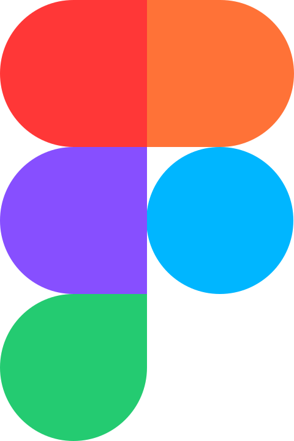

# ci

Icônes issues de bibliothèques et d’outils divers du projet. Répertoire source : `ci`.

Catalogue JSON : [icons.json](icons.json).

### Images SVG (8)

| Aperçu | Nom | Mots-clés | Taille | Fichier |
| --- | --- | --- | --- | --- |
|  | Ansible | divers, ci, ansible | 128 × 128 | [Ansible.svg](Ansible.svg) |
|  | ArgoCD | divers, ci, argocd | 128 × 128 | [ArgoCD.svg](ArgoCD.svg) |
|  | asciidoctor | divers, ci, asciidoctor | 800px × 800px | [asciidoctor.svg](asciidoctor.svg) |
|  | Figma | divers, ci, figma | 480 × 720 | [Figma.svg](Figma.svg) |
|  | GitLab | divers, ci, gitlab | 128 × 128 | [GitLab.svg](GitLab.svg) |
|  | Grafana | divers, ci, grafana | 128 × 128 | [Grafana.svg](Grafana.svg) |
|  | Helm | divers, ci, helm | 128 × 128 | [Helm.svg](Helm.svg) |
|  | Prometheus | divers, ci, prometheus | 128 × 128 | [Prometheus.svg](Prometheus.svg) |
