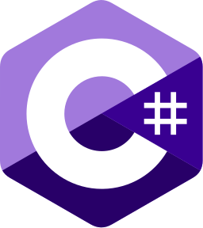
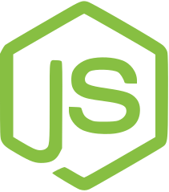
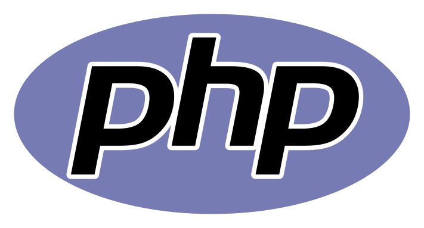

# lang

Icônes issues de bibliothèques et d’outils divers du projet. Répertoire source : `lang`.

Catalogue JSON : [icons.json](icons.json).

### Images SVG (7)

| Aperçu | Nom | Mots-clés | Taille | Fichier |
| --- | --- | --- | --- | --- |
|  | C_sharp | divers, lang, c, sharp | 256px × 288px | [C_sharp.svg](C_sharp.svg) |
|  | Java | divers, lang, java | 33.340314 × 45.205508 | [Java.svg](Java.svg) |
|  | Javascript | divers, lang, javascript | 45px × 45px | [Javascript.svg](Javascript.svg) |
|  | NodeJS | divers, lang, nodejs | 211px × 239px | [NodeJS.svg](NodeJS.svg) |
|  | PHP | divers, lang, php | 711.20123 × 383.5975 | [PHP.svg](PHP.svg) |
|  | Python | divers, lang, python | 47.405 × 47.932 | [Python.svg](Python.svg) |
|  | Typescript | divers, lang, typescript | 260 × 260 | [Typescript.svg](Typescript.svg) |
