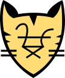
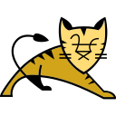
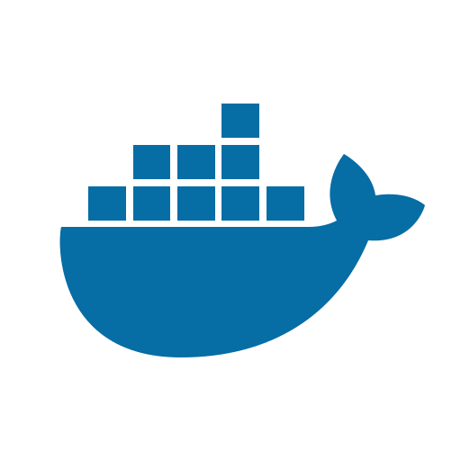
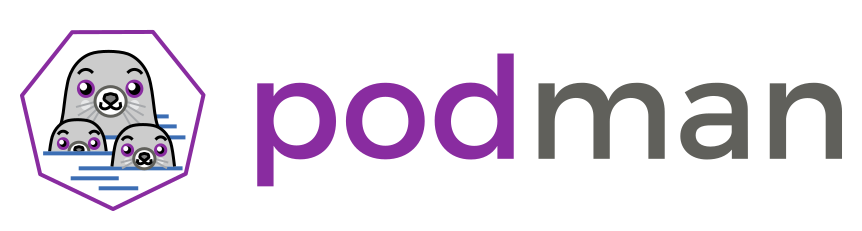
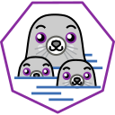
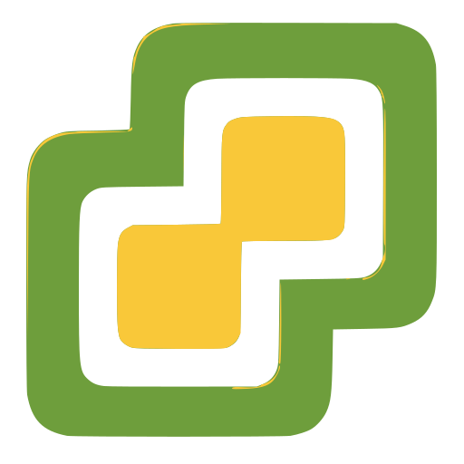

# socle

Icônes issues de bibliothèques et d’outils divers du projet. Répertoire source : `socle`.

Catalogue JSON : [icons.json](icons.json).

### Images SVG (24)

| Aperçu | Nom | Mots-clés | Taille | Fichier |
| --- | --- | --- | --- | --- |
|  | Apache-feather | divers, socle, apache, feather | 1e3 × 262.05 | [Apache-feather.svg](Apache-feather.svg) |
|  | Apache-Kafka | divers, socle, apache, kafka | 18.922 × 30.721 | [Apache-Kafka.svg](Apache-Kafka.svg) |
|  | Apache-Tomcat-Face | divers, socle, apache, tomcat, face | 108.95398 × 129.71484 | [Apache-Tomcat-Face.svg](Apache-Tomcat-Face.svg) |
|  | Apache-Tomcat | divers, socle, apache, tomcat | 128 × 128 | [Apache-Tomcat.svg](Apache-Tomcat.svg) |
|  | bucket | divers, socle, bucket | 45px × 47px | [bucket.svg](bucket.svg) |
|  | Debian | divers, socle, debian | 128 × 128 | [Debian.svg](Debian.svg) |
|  | Docker | divers, socle, docker | 512 × 512 | [Docker.svg](Docker.svg) |
|  | F5_Networks | divers, socle, f5, networks | 329.983165 × 303.045763 | [F5_Networks.svg](F5_Networks.svg) |
|  | keycloak-txt | divers, socle, keycloak, txt | 729.577 × 150.658 | [keycloak-txt.svg](keycloak-txt.svg) |
|  | keycloak | divers, socle, keycloak | 167.114 × 150.658 | [keycloak.svg](keycloak.svg) |
|  | kong-txt | divers, socle, kong, txt | 800px × 800px | [kong-txt.svg](kong-txt.svg) |
|  | kong | divers, socle, kong | 800px × 800px | [kong.svg](kong.svg) |
|  | Kubernetes | divers, socle, kubernetes | 128 × 128 | [Kubernetes.svg](Kubernetes.svg) |
|  | Nginx | divers, socle, nginx | 115.11875 × 24.187275 | [Nginx.svg](Nginx.svg) |
|  | Podman-txt | divers, socle, podman, txt | 862.71112 × 231.40778 | [Podman-txt.svg](Podman-txt.svg) |
|  | Podman | divers, socle, podman | 128 × 128 | [Podman.svg](Podman.svg) |
|  | Red_Hat-ghost | divers, socle, red, hat, ghost | 43.907001 × 38.836391 | [Red_Hat-ghost.svg](Red_Hat-ghost.svg) |
|  | Red_Hat-txt | divers, socle, red, hat, txt | 137px × 44px | [Red_Hat-txt.svg](Red_Hat-txt.svg) |
|  | Red_Hat | divers, socle, red, hat | 128 × 128 | [Red_Hat.svg](Red_Hat.svg) |
|  | Red_Hat_hat | divers, socle, red, hat | 192.3 × 146 | [Red_Hat_hat.svg](Red_Hat_hat.svg) |
|  | ServerDocuments | divers, socle, serverdocuments | 64px × 79px | [ServerDocuments.svg](ServerDocuments.svg) |
|  | sheduler | divers, socle, sheduler | 70px × 70px | [sheduler.svg](sheduler.svg) |
|  | spring-cloud-gateway | divers, socle, spring, cloud, gateway | 90 × 99.329079 | [spring-cloud-gateway.svg](spring-cloud-gateway.svg) |
|  | vmware | divers, socle, vmware | 512px × 512px | [vmware.svg](vmware.svg) |
