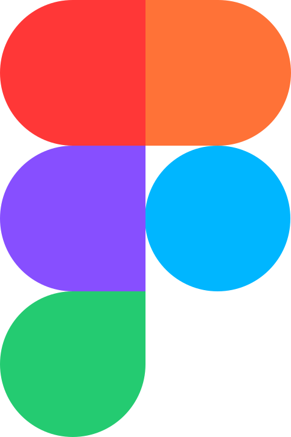

# tools

Icônes issues de bibliothèques et d’outils divers du projet. Répertoire source : `tools`.

Catalogue JSON : [icons.json](icons.json).

### Images SVG (3)

| Aperçu | Nom | Mots-clés | Taille | Fichier |
| --- | --- | --- | --- | --- |
|  | Figma | divers, tools, figma | 480 × 720 | [Figma.svg](Figma.svg) |
|  | Visual_Studio_Code_1.35_icon | divers, tools, visual, studio, code, 1, 35, icon | 100 × 100 | [Visual_Studio_Code_1.35_icon.svg](Visual_Studio_Code_1.35_icon.svg) |
|  | webstorm-black | divers, tools, webstorm, black | 24px × 24px | [webstorm-black.svg](webstorm-black.svg) |
