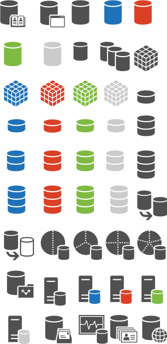

# Databases

Icônes Office Symbols 2014 organisées par domaine fonctionnel. Répertoire source : `Databases`.

Catalogue JSON : [icons.json](icons.json).

### Images SVG (45)

| Aperçu | Nom | Mots-clés | Taille | Fichier |
| --- | --- | --- | --- | --- |
|  | Address_Book_Store | officesymbols, databases, address, book, store | 89.025 × 97.5 | [Address_Book_Store.svg](Address_Book_Store.svg) |
|  | Application_Store | officesymbols, databases, application, store | 88.5 × 97.5 | [Application_Store.svg](Application_Store.svg) |
|  | Database-blue | officesymbols, databases, database, blue | 73.5 × 91.5 | [Database-blue.svg](Database-blue.svg) |
|  | Database-ghosted | officesymbols, databases, database, ghosted | 72 × 91.5 | [Database-ghosted.svg](Database-ghosted.svg) |
|  | Database-green | officesymbols, databases, database, green | 73.5 × 91.5 | [Database-green.svg](Database-green.svg) |
|  | Database-orange | officesymbols, databases, database, orange | 73.5 × 91.5 | [Database-orange.svg](Database-orange.svg) |
|  | Database | officesymbols, databases, database | 75 × 91.5 | [Database.svg](Database.svg) |
|  | Database_Availability_Group | officesymbols, databases, database, availability, group | 105 × 91.5 | [Database_Availability_Group.svg](Database_Availability_Group.svg) |
|  | Database_Cube-blue | officesymbols, databases, database, cube, blue | 85.5 × 94.5 | [Database_Cube-blue.svg](Database_Cube-blue.svg) |
|  | Database_Cube-ghosted | officesymbols, databases, database, cube, ghosted | 84 × 94.5 | [Database_Cube-ghosted.svg](Database_Cube-ghosted.svg) |
|  | Database_Cube-green | officesymbols, databases, database, cube, green | 84 × 94.5 | [Database_Cube-green.svg](Database_Cube-green.svg) |
|  | Database_Cube-orange | officesymbols, databases, database, cube, orange | 85.5 × 94.5 | [Database_Cube-orange.svg](Database_Cube-orange.svg) |
|  | Database_Cube | officesymbols, databases, database, cube | 85.5 × 94.5 | [Database_Cube.svg](Database_Cube.svg) |
|  | Database_mini_1-blue | officesymbols, databases, database, mini, 1, blue | 75 × 61.5 | [Database_mini_1-blue.svg](Database_mini_1-blue.svg) |
|  | Database_mini_1-ghosted | officesymbols, databases, database, mini, 1, ghosted | 73.5 × 61.5 | [Database_mini_1-ghosted.svg](Database_mini_1-ghosted.svg) |
|  | Database_mini_1-green | officesymbols, databases, database, mini, 1, green | 73.5 × 61.5 | [Database_mini_1-green.svg](Database_mini_1-green.svg) |
|  | Database_mini_1-orange | officesymbols, databases, database, mini, 1, orange | 73.5 × 61.5 | [Database_mini_1-orange.svg](Database_mini_1-orange.svg) |
|  | Database_mini_1 | officesymbols, databases, database, mini, 1 | 75 × 61.5 | [Database_mini_1.svg](Database_mini_1.svg) |
|  | Database_mini_2-blue | officesymbols, databases, database, mini, 2, blue | 70.5 × 81 | [Database_mini_2-blue.svg](Database_mini_2-blue.svg) |
|  | Database_mini_2-ghosted | officesymbols, databases, database, mini, 2, ghosted | 70.5 × 81 | [Database_mini_2-ghosted.svg](Database_mini_2-ghosted.svg) |
|  | Database_mini_2-green | officesymbols, databases, database, mini, 2, green | 70.5 × 81 | [Database_mini_2-green.svg](Database_mini_2-green.svg) |
|  | Database_mini_2-orange | officesymbols, databases, database, mini, 2, orange | 70.5 × 81 | [Database_mini_2-orange.svg](Database_mini_2-orange.svg) |
|  | Database_mini_2 | officesymbols, databases, database, mini, 2 | 72 × 81 | [Database_mini_2.svg](Database_mini_2.svg) |
|  | Database_mini_3-blue | officesymbols, databases, database, mini, 3, blue | 72 × 97.5 | [Database_mini_3-blue.svg](Database_mini_3-blue.svg) |
|  | Database_mini_3-ghosted | officesymbols, databases, database, mini, 3, ghosted | 70.5 × 97.5 | [Database_mini_3-ghosted.svg](Database_mini_3-ghosted.svg) |
|  | Database_mini_3-green | officesymbols, databases, database, mini, 3, green | 70.5 × 97.5 | [Database_mini_3-green.svg](Database_mini_3-green.svg) |
|  | Database_mini_3-orange | officesymbols, databases, database, mini, 3, orange | 72 × 97.5 | [Database_mini_3-orange.svg](Database_mini_3-orange.svg) |
|  | Database_mini_3 | officesymbols, databases, database, mini, 3 | 72 × 97.5 | [Database_mini_3.svg](Database_mini_3.svg) |
|  | Database_Mirror | officesymbols, databases, database, mirror | 106.5 × 94.5 | [Database_Mirror.svg](Database_Mirror.svg) |
|  | Database_Mirror_Witness_Node | officesymbols, databases, database, mirror, witness, node | 60px × 59px | [Database_Mirror_Witness_Node.svg](Database_Mirror_Witness_Node.svg) |
|  | Database_Partition_2 | officesymbols, databases, database, partition, 2 | 96 × 93 | [Database_Partition_2.svg](Database_Partition_2.svg) |
|  | Database_Partition_3 | officesymbols, databases, database, partition, 3 | 96 × 93 | [Database_Partition_3.svg](Database_Partition_3.svg) |
|  | Database_Partition_4 | officesymbols, databases, database, partition, 4 | 96 × 93 | [Database_Partition_4.svg](Database_Partition_4.svg) |
|  | Database_Partition_5 | officesymbols, databases, database, partition, 5 | 96 × 93 | [Database_Partition_5.svg](Database_Partition_5.svg) |
|  | Database_Public_Folder | officesymbols, databases, database, public, folder | 97.125 × 97.5 | [Database_Public_Folder.svg](Database_Public_Folder.svg) |
|  | Database_Server-blue | officesymbols, databases, database, server, blue | 78 × 94.5 | [Database_Server-blue.svg](Database_Server-blue.svg) |
|  | Database_Server-ghosted | officesymbols, databases, database, server, ghosted | 78 × 94.5 | [Database_Server-ghosted.svg](Database_Server-ghosted.svg) |
|  | Database_Server-green | officesymbols, databases, database, server, green | 78 × 94.5 | [Database_Server-green.svg](Database_Server-green.svg) |
|  | Database_Server-orange | officesymbols, databases, database, server, orange | 78 × 94.5 | [Database_Server-orange.svg](Database_Server-orange.svg) |
|  | Database_Server | officesymbols, databases, database, server | 78 × 94.5 | [Database_Server.svg](Database_Server.svg) |
|  | lib-office-databases-drawio | officesymbols, databases, lib, office, drawio | 334px × 687px | [lib-office-databases-drawio.svg](lib-office-databases-drawio.svg) |
|  | Mailbox_Database | officesymbols, databases, mailbox, database | 92.625 × 97.5 | [Mailbox_Database.svg](Mailbox_Database.svg) |
|  | Monitoring_Store | officesymbols, databases, monitoring, store | 99 × 93 | [Monitoring_Store.svg](Monitoring_Store.svg) |
|  | Unified_Contact_Store | officesymbols, databases, unified, contact, store | 90.825 × 97.5 | [Unified_Contact_Store.svg](Unified_Contact_Store.svg) |
|  | Web_Store | officesymbols, databases, web, store | 87 × 94.5 | [Web_Store.svg](Web_Store.svg) |
