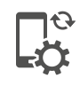
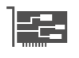
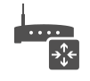
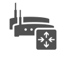

# Devices

Icônes Office Symbols 2014 organisées par domaine fonctionnel. Répertoire source : `Devices`.

Catalogue JSON : [icons.json](icons.json).

### Images SVG (48)

| Aperçu | Nom | Mots-clés | Taille | Fichier |
| --- | --- | --- | --- | --- |
|  | CD-DVD | officesymbols, devices, cd, dvd | 90 × 88.5 | [CD-DVD.svg](CD-DVD.svg) |
|  | Cell_Phone_Android_Proportional | officesymbols, devices, cell, phone, android, proportional | 46.5 × 63 | [Cell_Phone_Android_Proportional.svg](Cell_Phone_Android_Proportional.svg) |
|  | Cell_Phone_Android_Stand-alone | officesymbols, devices, cell, phone, android, stand, alone | 52.5 × 76.5 | [Cell_Phone_Android_Stand-alone.svg](Cell_Phone_Android_Stand-alone.svg) |
|  | Cell_Phone_Generic | officesymbols, devices, cell, phone, generic | 26px × 47px | [Cell_Phone_Generic.svg](Cell_Phone_Generic.svg) |
|  | Cell_Phone_iPhone_Proportional | officesymbols, devices, cell, phone, iphone, proportional | 42 × 58.5 | [Cell_Phone_iPhone_Proportional.svg](Cell_Phone_iPhone_Proportional.svg) |
|  | Cell_Phone_iPhone_Stand-alone | officesymbols, devices, cell, phone, iphone, stand, alone | 48 × 75 | [Cell_Phone_iPhone_Stand-alone.svg](Cell_Phone_iPhone_Stand-alone.svg) |
|  | Cell_Phone_Windows_Phone_Proportional | officesymbols, devices, cell, phone, windows, proportional | 39 × 55.5 | [Cell_Phone_Windows_Phone_Proportional.svg](Cell_Phone_Windows_Phone_Proportional.svg) |
|  | Cell_Phone_Windows_Phone_Stand-alone | officesymbols, devices, cell, phone, windows, stand, alone | 49.5 × 73.5 | [Cell_Phone_Windows_Phone_Stand-alone.svg](Cell_Phone_Windows_Phone_Stand-alone.svg) |
|  | Data_Jack | officesymbols, devices, data, jack | 85.5 × 85.5 | [Data_Jack.svg](Data_Jack.svg) |
|  | Device_Bluetooth | officesymbols, devices, device, bluetooth | 87 × 97.5 | [Device_Bluetooth.svg](Device_Bluetooth.svg) |
|  | Device_Fax | officesymbols, devices, device, fax | 102 × 85.5 | [Device_Fax.svg](Device_Fax.svg) |
|  | Device_Headset | officesymbols, devices, device, headset | 75 × 87 | [Device_Headset.svg](Device_Headset.svg) |
|  | Device_Laptop | officesymbols, devices, device, laptop | 58px × 34px | [Device_Laptop.svg](Device_Laptop.svg) |
|  | Device_LCD_Monitor | officesymbols, devices, device, lcd, monitor | 58px × 48px | [Device_LCD_Monitor.svg](Device_LCD_Monitor.svg) |
|  | Device_Mac_Client | officesymbols, devices, device, mac, client | 105 × 88.5 | [Device_Mac_Client.svg](Device_Mac_Client.svg) |
|  | Device_Microphone | officesymbols, devices, device, microphone | 90 × 73.5 | [Device_Microphone.svg](Device_Microphone.svg) |
|  | Device_Phone_Digital | officesymbols, devices, device, phone, digital | 93 × 82.5 | [Device_Phone_Digital.svg](Device_Phone_Digital.svg) |
|  | Device_Phone_Traditional | officesymbols, devices, device, phone, traditional | 85.5 × 79.5 | [Device_Phone_Traditional.svg](Device_Phone_Traditional.svg) |
|  | Device_Phone_USB | officesymbols, devices, device, phone, usb | 103.5 × 83.25 | [Device_Phone_USB.svg](Device_Phone_USB.svg) |
|  | Device_Phone_VoIP | officesymbols, devices, device, phone, voip | 99 × 85.5 | [Device_Phone_VoIP.svg](Device_Phone_VoIP.svg) |
|  | Device_Printer | officesymbols, devices, device, printer | 102 × 88.5 | [Device_Printer.svg](Device_Printer.svg) |
|  | Device_RoundTable | officesymbols, devices, device, roundtable | 76.5 × 103.5 | [Device_RoundTable.svg](Device_RoundTable.svg) |
|  | Device_Stylus | officesymbols, devices, device, stylus | 85.75 × 85.5 | [Device_Stylus.svg](Device_Stylus.svg) |
|  | Device_Tablet_Android | officesymbols, devices, device, tablet, android | 103.5 × 76.5 | [Device_Tablet_Android.svg](Device_Tablet_Android.svg) |
|  | Device_Tablet_iPad | officesymbols, devices, device, tablet, ipad | 39px × 52px | [Device_Tablet_iPad.svg](Device_Tablet_iPad.svg) |
|  | Device_Tablet_iPad_Mini | officesymbols, devices, device, tablet, ipad, mini | 75 × 91.5 | [Device_Tablet_iPad_Mini.svg](Device_Tablet_iPad_Mini.svg) |
|  | Device_Tablet_Windows_7-inch | officesymbols, devices, device, tablet, windows, 7, inch | 76.5 × 91.5 | [Device_Tablet_Windows_7-inch.svg](Device_Tablet_Windows_7-inch.svg) |
|  | Device_Tablet_Windows_8 | officesymbols, devices, device, tablet, windows, 8 | 106.5 × 76.5 | [Device_Tablet_Windows_8.svg](Device_Tablet_Windows_8.svg) |
|  | Device_TV | officesymbols, devices, device, tv | 108 × 87 | [Device_TV.svg](Device_TV.svg) |
|  | Device_Update_Service | officesymbols, devices, device, update, service | 90 × 97.5 | [Device_Update_Service.svg](Device_Update_Service.svg) |
|  | Device_Webcam | officesymbols, devices, device, webcam | 81 × 97.5 | [Device_Webcam.svg](Device_Webcam.svg) |
|  | Device_Webcam_HD | officesymbols, devices, device, webcam, hd | 93 × 103.5 | [Device_Webcam_HD.svg](Device_Webcam_HD.svg) |
|  | Hard_Disk | officesymbols, devices, hard, disk | 82.5 × 97.5 | [Hard_Disk.svg](Hard_Disk.svg) |
|  | IP-PBX | officesymbols, devices, ip, pbx | 111 × 72 | [IP-PBX.svg](IP-PBX.svg) |
|  | IP_Gateway | officesymbols, devices, ip, gateway | 111 × 72 | [IP_Gateway.svg](IP_Gateway.svg) |
|  | Load_Balancer | officesymbols, devices, load, balancer | 111 × 73.5 | [Load_Balancer.svg](Load_Balancer.svg) |
|  | Management_Console | officesymbols, devices, management, console | 58px × 48px | [Management_Console.svg](Management_Console.svg) |
|  | Modem | officesymbols, devices, modem | 97.125 × 63 | [Modem.svg](Modem.svg) |
|  | NIC | officesymbols, devices, nic | 99 × 73.5 | [NIC.svg](NIC.svg) |
|  | Router | officesymbols, devices, router | 101.1 × 91.75 | [Router.svg](Router.svg) |
|  | Session_Border_Controller | officesymbols, devices, session, border, controller | 108 × 79.5 | [Session_Border_Controller.svg](Session_Border_Controller.svg) |
|  | Shadowed_Router | officesymbols, devices, shadowed, router | 108 × 96 | [Shadowed_Router.svg](Shadowed_Router.svg) |
|  | Switch | officesymbols, devices, switch | 106.5 × 55.5 | [Switch.svg](Switch.svg) |
|  | Video_Camera | officesymbols, devices, video, camera | 99.525 × 58.5 | [Video_Camera.svg](Video_Camera.svg) |
|  | Video_Gateway | officesymbols, devices, video, gateway | 106.5 × 82.5 | [Video_Gateway.svg](Video_Gateway.svg) |
|  | Workstation | officesymbols, devices, workstation | 98.4 × 100.5 | [Workstation.svg](Workstation.svg) |
|  | Workstation_PC | officesymbols, devices, workstation, pc | 98.7 × 102 | [Workstation_PC.svg](Workstation_PC.svg) |
|  | Workstation_Visual_Studio | officesymbols, devices, workstation, visual, studio | 99 × 100.5 | [Workstation_Visual_Studio.svg](Workstation_Visual_Studio.svg) |
