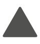
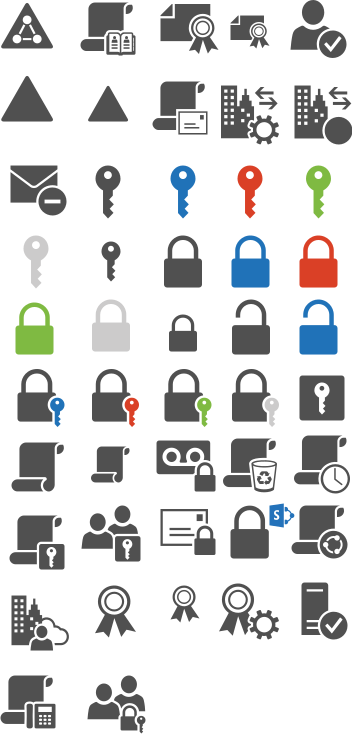

# Security

Icônes Office Symbols 2014 organisées par domaine fonctionnel. Répertoire source : `Security`.

Catalogue JSON : [icons.json](icons.json).

### Images SVG (46)

| Aperçu | Nom | Mots-clés | Taille | Fichier |
| --- | --- | --- | --- | --- |
|  | Active_Directory | officesymbols, security, active, directory | 53px × 46px | [Active_Directory.svg](Active_Directory.svg) |
|  | Address_Book_Policies | officesymbols, security, address, book, policies | 85.5 × 97.5 | [Address_Book_Policies.svg](Address_Book_Policies.svg) |
|  | Certificate | officesymbols, security, certificate | 104.1 × 88.5 | [Certificate.svg](Certificate.svg) |
|  | Credentials | officesymbols, security, credentials | 94.5 × 96 | [Credentials.svg](Credentials.svg) |
|  | Domain | officesymbols, security, domain | 79.5 × 88.5 | [Domain.svg](Domain.svg) |
|  | Email_Address_Policy | officesymbols, security, email, address, policy | 87 × 97.5 | [Email_Address_Policy.svg](Email_Address_Policy.svg) |
|  | Federation_Service | officesymbols, security, federation, service | 99 × 99 | [Federation_Service.svg](Federation_Service.svg) |
|  | Federation_Trust | officesymbols, security, federation, trust | 99 × 97.5 | [Federation_Trust.svg](Federation_Trust.svg) |
|  | IRM-Protected_Message | officesymbols, security, irm, protected, message | 101.7 × 88.5 | [IRM-Protected_Message.svg](IRM-Protected_Message.svg) |
|  | Key_Permissions-blue | officesymbols, security, key, permissions, blue | 60 × 97.5 | [Key_Permissions-blue.svg](Key_Permissions-blue.svg) |
|  | Key_Permissions-ghosted | officesymbols, security, key, permissions, ghosted | 57 × 97.5 | [Key_Permissions-ghosted.svg](Key_Permissions-ghosted.svg) |
|  | Key_Permissions-green | officesymbols, security, key, permissions, green | 58.5 × 97.5 | [Key_Permissions-green.svg](Key_Permissions-green.svg) |
|  | Key_Permissions-orange | officesymbols, security, key, permissions, orange | 57 × 97.5 | [Key_Permissions-orange.svg](Key_Permissions-orange.svg) |
|  | Key_Permissions | officesymbols, security, key, permissions | 58.5 × 97.5 | [Key_Permissions.svg](Key_Permissions.svg) |
|  | lib-office-security-drawio | officesymbols, security, lib, office, drawio | 352px × 734px | [lib-office-security-drawio.svg](lib-office-security-drawio.svg) |
|  | Lock_Protected-blue | officesymbols, security, lock, protected, blue | 78 × 97.5 | [Lock_Protected-blue.svg](Lock_Protected-blue.svg) |
|  | Lock_Protected-ghosted | officesymbols, security, lock, protected, ghosted | 79.5 × 97.5 | [Lock_Protected-ghosted.svg](Lock_Protected-ghosted.svg) |
|  | Lock_Protected-green | officesymbols, security, lock, protected, green | 79.5 × 97.5 | [Lock_Protected-green.svg](Lock_Protected-green.svg) |
|  | Lock_Protected-orange | officesymbols, security, lock, protected, orange | 79.5 × 97.5 | [Lock_Protected-orange.svg](Lock_Protected-orange.svg) |
|  | Lock_Protected | officesymbols, security, lock, protected | 78 × 97.5 | [Lock_Protected.svg](Lock_Protected.svg) |
|  | Lock_Unprotected-blue | officesymbols, security, lock, unprotected, blue | 78 × 100.5 | [Lock_Unprotected-blue.svg](Lock_Unprotected-blue.svg) |
|  | Lock_Unprotected-ghosted | officesymbols, security, lock, unprotected, ghosted | 79.5 × 100.5 | [Lock_Unprotected-ghosted.svg](Lock_Unprotected-ghosted.svg) |
|  | Lock_Unprotected-green | officesymbols, security, lock, unprotected, green | 78 × 100.5 | [Lock_Unprotected-green.svg](Lock_Unprotected-green.svg) |
|  | Lock_Unprotected-orange | officesymbols, security, lock, unprotected, orange | 78 × 100.5 | [Lock_Unprotected-orange.svg](Lock_Unprotected-orange.svg) |
|  | Lock_Unprotected | officesymbols, security, lock, unprotected | 78 × 100.5 | [Lock_Unprotected.svg](Lock_Unprotected.svg) |
|  | Lock_with_Key_Security-blue | officesymbols, security, lock, with, key, blue | 87 × 99 | [Lock_with_Key_Security-blue.svg](Lock_with_Key_Security-blue.svg) |
|  | Lock_with_Key_Security-ghosted | officesymbols, security, lock, with, key, ghosted | 87 × 99 | [Lock_with_Key_Security-ghosted.svg](Lock_with_Key_Security-ghosted.svg) |
|  | Lock_with_Key_Security-green | officesymbols, security, lock, with, key, green | 85.5 × 99 | [Lock_with_Key_Security-green.svg](Lock_with_Key_Security-green.svg) |
|  | Lock_with_Key_Security-orange | officesymbols, security, lock, with, key, orange | 85.5 × 99 | [Lock_with_Key_Security-orange.svg](Lock_with_Key_Security-orange.svg) |
|  | Lock_with_Key_Security | officesymbols, security, lock, with, key | 87 × 99 | [Lock_with_Key_Security.svg](Lock_with_Key_Security.svg) |
|  | Management_Role | officesymbols, security, management, role | 87 × 87 | [Management_Role.svg](Management_Role.svg) |
|  | Policy | officesymbols, security, policy | 84 × 91.5 | [Policy.svg](Policy.svg) |
|  | Protected_Voice_Mail | officesymbols, security, protected, voice, mail | 106.5 × 87 | [Protected_Voice_Mail.svg](Protected_Voice_Mail.svg) |
|  | Retention_Policy | officesymbols, security, retention, policy | 88.25 × 93 | [Retention_Policy.svg](Retention_Policy.svg) |
|  | Retention_Policy_Tag | officesymbols, security, retention, policy, tag | 87 × 97.5 | [Retention_Policy_Tag.svg](Retention_Policy_Tag.svg) |
|  | Role_Assignment_Policy | officesymbols, security, role, assignment, policy | 91.5 × 97.5 | [Role_Assignment_Policy.svg](Role_Assignment_Policy.svg) |
|  | Role_Group | officesymbols, security, role, group | 99.825 × 87 | [Role_Group.svg](Role_Group.svg) |
|  | Secure_Messaging | officesymbols, security, secure, messaging | 99.9 × 81 | [Secure_Messaging.svg](Secure_Messaging.svg) |
|  | Security_Access_Portal | officesymbols, security, access, portal | 103.5 × 94.5 | [Security_Access_Portal.svg](Security_Access_Portal.svg) |
|  | Sharing_Policy | officesymbols, security, sharing, policy | 85.5 × 93 | [Sharing_Policy.svg](Sharing_Policy.svg) |
|  | Split-Domain_User | officesymbols, security, split, domain, user | 97.5 × 93 | [Split-Domain_User.svg](Split-Domain_User.svg) |
|  | Token | officesymbols, security, token | 29px × 37px | [Token.svg](Token.svg) |
|  | Token_Service | officesymbols, security, token, service | 97.125 × 93 | [Token_Service.svg](Token_Service.svg) |
|  | Trusted_Application_Server | officesymbols, security, trusted, application, server | 84 × 100.5 | [Trusted_Application_Server.svg](Trusted_Application_Server.svg) |
|  | UM_Mailbox_Policy | officesymbols, security, um, mailbox, policy | 94.5 × 100.5 | [UM_Mailbox_Policy.svg](UM_Mailbox_Policy.svg) |
|  | Universal_Security_Group | officesymbols, security, universal, group | 105 × 88.5 | [Universal_Security_Group.svg](Universal_Security_Group.svg) |
