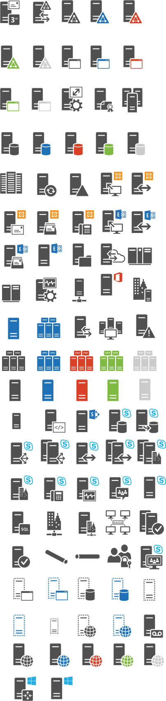

# Servers

Icônes Office Symbols 2014 organisées par domaine fonctionnel. Répertoire source : `Servers`.

Catalogue JSON : [icons.json](icons.json).

### Images SVG (99)

| Aperçu | Nom | Mots-clés | Taille | Fichier |
| --- | --- | --- | --- | --- |
|  | 3rd-Party_Mail_Server | officesymbols, servers, 3rd, party, mail, server | 84 × 103.5 | [3rd-Party_Mail_Server.svg](3rd-Party_Mail_Server.svg) |
|  | Active_Directory_Federation_Services_Proxy | officesymbols, servers, active, directory, federation, services, proxy | 82.5 × 97.5 | [Active_Directory_Federation_Services_Proxy.svg](Active_Directory_Federation_Services_Proxy.svg) |
|  | Active_Directory_Federation_Services_Server-blue | officesymbols, servers, active, directory, federation, services, server, blue | 77.627 × 97.5 | [Active_Directory_Federation_Services_Server-blue.svg](Active_Directory_Federation_Services_Server-blue.svg) |
|  | Active_Directory_Federation_Services_Server-ghosted | officesymbols, servers, active, directory, federation, services, server, ghosted | 76.877 × 97.5 | [Active_Directory_Federation_Services_Server-ghosted.svg](Active_Directory_Federation_Services_Server-ghosted.svg) |
|  | Active_Directory_Federation_Services_Server-green | officesymbols, servers, active, directory, federation, services, server, green | 76.677 × 97.5 | [Active_Directory_Federation_Services_Server-green.svg](Active_Directory_Federation_Services_Server-green.svg) |
|  | Active_Directory_Federation_Services_Server-orange | officesymbols, servers, active, directory, federation, services, server, orange | 76.377 × 97.5 | [Active_Directory_Federation_Services_Server-orange.svg](Active_Directory_Federation_Services_Server-orange.svg) |
|  | Active_Directory_Federation_Services_Server | officesymbols, servers, active, directory, federation, services, server | 45px × 56px | [Active_Directory_Federation_Services_Server.svg](Active_Directory_Federation_Services_Server.svg) |
|  | Application_Server-blue | officesymbols, servers, application, server, blue | 79.5 × 97.5 | [Application_Server-blue.svg](Application_Server-blue.svg) |
|  | Application_Server-ghosted | officesymbols, servers, application, server, ghosted | 79.5 × 97.5 | [Application_Server-ghosted.svg](Application_Server-ghosted.svg) |
|  | Application_Server-green | officesymbols, servers, application, server, green | 78.3 × 97.5 | [Application_Server-green.svg](Application_Server-green.svg) |
|  | Application_Server-orange | officesymbols, servers, application, server, orange | 79.5 × 97.5 | [Application_Server-orange.svg](Application_Server-orange.svg) |
|  | Application_Server | officesymbols, servers, application, server | 79.5 × 97.5 | [Application_Server.svg](Application_Server.svg) |
|  | Call_Admission_Control_Service | officesymbols, servers, call, admission, control, service | 88.5 × 99 | [Call_Admission_Control_Service.svg](Call_Admission_Control_Service.svg) |
|  | Certificate_Authority | officesymbols, servers, certificate, authority | 78.45 × 94.5 | [Certificate_Authority.svg](Certificate_Authority.svg) |
|  | Cluster_Server-ghosted | officesymbols, servers, cluster, server, ghosted | 88.5 × 102 | [Cluster_Server-ghosted.svg](Cluster_Server-ghosted.svg) |
|  | Cluster_Server | officesymbols, servers, cluster, server | 90 × 102 | [Cluster_Server.svg](Cluster_Server.svg) |
|  | Cluster_Server_-blue | officesymbols, servers, cluster, server, blue | 90 × 102 | [Cluster_Server_-blue.svg](Cluster_Server_-blue.svg) |
|  | Cluster_Server_-green | officesymbols, servers, cluster, server, green | 88.5 × 102 | [Cluster_Server_-green.svg](Cluster_Server_-green.svg) |
|  | Cluster_Server_-orange | officesymbols, servers, cluster, server, orange | 90 × 102 | [Cluster_Server_-orange.svg](Cluster_Server_-orange.svg) |
|  | Database_Server-blue | officesymbols, servers, database, server, blue | 79.5 × 94.5 | [Database_Server-blue.svg](Database_Server-blue.svg) |
|  | Database_Server-ghosted | officesymbols, servers, database, server, ghosted | 81 × 94.5 | [Database_Server-ghosted.svg](Database_Server-ghosted.svg) |
|  | Database_Server-green | officesymbols, servers, database, server, green | 81 × 94.5 | [Database_Server-green.svg](Database_Server-green.svg) |
|  | Database_Server-orange | officesymbols, servers, database, server, orange | 79.5 × 94.5 | [Database_Server-orange.svg](Database_Server-orange.svg) |
|  | Database_Server | officesymbols, servers, database, server | 79.5 × 94.5 | [Database_Server.svg](Database_Server.svg) |
|  | Datacenter | officesymbols, servers, datacenter | 79 × 79 | [Datacenter.svg](Datacenter.svg) |
|  | DirSync_Server | officesymbols, servers, dirsync, server | 81 × 93 | [DirSync_Server.svg](DirSync_Server.svg) |
|  | Domain_Controller | officesymbols, servers, domain, controller | 78 × 97.5 | [Domain_Controller.svg](Domain_Controller.svg) |
|  | Exchange_2010_Client_Access_Server_Role | officesymbols, servers, exchange, 2010, client, access, server, role | 88.35 × 100.5 | [Exchange_2010_Client_Access_Server_Role.svg](Exchange_2010_Client_Access_Server_Role.svg) |
|  | Exchange_2010_Edge_Transport_Server_Role | officesymbols, servers, exchange, 2010, edge, transport, server, role | 87.525 × 94.5 | [Exchange_2010_Edge_Transport_Server_Role.svg](Exchange_2010_Edge_Transport_Server_Role.svg) |
|  | Exchange_2010_Hub_Transport_Server_Role | officesymbols, servers, exchange, 2010, hub, transport, server, role | 87.525 × 99 | [Exchange_2010_Hub_Transport_Server_Role.svg](Exchange_2010_Hub_Transport_Server_Role.svg) |
|  | Exchange_2010_Mailbox_Server_Role | officesymbols, servers, exchange, 2010, mailbox, server, role | 87.175 × 99 | [Exchange_2010_Mailbox_Server_Role.svg](Exchange_2010_Mailbox_Server_Role.svg) |
|  | Exchange_2010_UM_Server_Role | officesymbols, servers, exchange, 2010, um, server, role | 87.825 × 99 | [Exchange_2010_UM_Server_Role.svg](Exchange_2010_UM_Server_Role.svg) |
|  | Exchange_2013_Client_Access_Server | officesymbols, servers, exchange, 2013, client, access, server | 96 × 100.5 | [Exchange_2013_Client_Access_Server.svg](Exchange_2013_Client_Access_Server.svg) |
|  | Exchange_2013_Edge_Transport_Server | officesymbols, servers, exchange, 2013, edge, transport, server | 94.5 × 93 | [Exchange_2013_Edge_Transport_Server.svg](Exchange_2013_Edge_Transport_Server.svg) |
|  | Exchange_2013_Mailbox_Server | officesymbols, servers, exchange, 2013, mailbox, server | 94.7 × 97.5 | [Exchange_2013_Mailbox_Server.svg](Exchange_2013_Mailbox_Server.svg) |
|  | Exchange_2013_Server | officesymbols, servers, exchange, 2013, server | 94.5 × 93 | [Exchange_2013_Server.svg](Exchange_2013_Server.svg) |
|  | File_Server | officesymbols, servers, file, server | 84 × 99 | [File_Server.svg](File_Server.svg) |
|  | Hybrid_Server | officesymbols, servers, hybrid, server | 100.5 × 91.5 | [Hybrid_Server.svg](Hybrid_Server.svg) |
|  | lib-office-servers-drawio | officesymbols, servers, lib, office, drawio | 404px × 1700px | [lib-office-servers-drawio.svg](lib-office-servers-drawio.svg) |
|  | Mainframe | officesymbols, servers, mainframe | 102 × 79.5 | [Mainframe.svg](Mainframe.svg) |
|  | Mainframe_Host | officesymbols, servers, mainframe, host | 82.5 × 78 | [Mainframe_Host.svg](Mainframe_Host.svg) |
|  | Monitoring_SQL_Reporting_Services | officesymbols, servers, monitoring, sql, reporting, services | 87 × 97.5 | [Monitoring_SQL_Reporting_Services.svg](Monitoring_SQL_Reporting_Services.svg) |
|  | Network | officesymbols, servers, network | 53 × 84 | [Network.svg](Network.svg) |
|  | Office_Web_Apps_Server | officesymbols, servers, office, web, apps, server | 89.325 × 94.5 | [Office_Web_Apps_Server.svg](Office_Web_Apps_Server.svg) |
|  | On-premises_Server | officesymbols, servers, on, premises, server | 82.5 × 94.5 | [On-premises_Server.svg](On-premises_Server.svg) |
|  | Physical_Host-solid_blue | officesymbols, servers, physical, host, solid, blue | 63 × 94.5 | [Physical_Host-solid_blue.svg](Physical_Host-solid_blue.svg) |
|  | Physical_Host_Farm-solid_blue | officesymbols, servers, physical, host, farm, solid, blue | 100.5 × 88.5 | [Physical_Host_Farm-solid_blue.svg](Physical_Host_Farm-solid_blue.svg) |
|  | Reverse_Proxy | officesymbols, servers, reverse, proxy | 72.05 × 93 | [Reverse_Proxy.svg](Reverse_Proxy.svg) |
|  | SCOM | officesymbols, servers, scom | 97.125 × 94.5 | [SCOM.svg](SCOM.svg) |
|  | Server-side_Code | officesymbols, servers, server, side, code | 84 × 97.5 | [Server-side_Code.svg](Server-side_Code.svg) |
|  | Server_Disaster | officesymbols, servers, server, disaster | 69.027 × 84 | [Server_Disaster.svg](Server_Disaster.svg) |
|  | Server_Farm-blue | officesymbols, servers, server, farm, blue | 97.125 × 87 | [Server_Farm-blue.svg](Server_Farm-blue.svg) |
|  | Server_Farm-ghosted | officesymbols, servers, server, farm, ghosted | 97.125 × 87 | [Server_Farm-ghosted.svg](Server_Farm-ghosted.svg) |
|  | Server_Farm-green | officesymbols, servers, server, farm, green | 97.125 × 87 | [Server_Farm-green.svg](Server_Farm-green.svg) |
|  | Server_Farm-orange | officesymbols, servers, server, farm, orange | 97.125 × 87 | [Server_Farm-orange.svg](Server_Farm-orange.svg) |
|  | Server_Farm | officesymbols, servers, server, farm | 97.125 × 87 | [Server_Farm.svg](Server_Farm.svg) |
|  | Server_Generic-blue | officesymbols, servers, server, generic, blue | 61.5 × 94.5 | [Server_Generic-blue.svg](Server_Generic-blue.svg) |
|  | Server_Generic-ghosted | officesymbols, servers, server, generic, ghosted | 60 × 94.5 | [Server_Generic-ghosted.svg](Server_Generic-ghosted.svg) |
|  | Server_Generic-green | officesymbols, servers, server, generic, green | 61.5 × 94.5 | [Server_Generic-green.svg](Server_Generic-green.svg) |
|  | Server_Generic-orange | officesymbols, servers, server, generic, orange | 61.5 × 94.5 | [Server_Generic-orange.svg](Server_Generic-orange.svg) |
|  | Server_Generic | officesymbols, servers, server, generic | 63 × 94.5 | [Server_Generic.svg](Server_Generic.svg) |
|  | SharePoint_Server | officesymbols, servers, sharepoint, server | 94.5 × 93 | [SharePoint_Server.svg](SharePoint_Server.svg) |
|  | Skype_for_Business_Back-End_Server | officesymbols, servers, skype, for, business, back, end, server | 92.325 × 97.5 | [Skype_for_Business_Back-End_Server.svg](Skype_for_Business_Back-End_Server.svg) |
|  | Skype_for_Business_Back-End_Server_Mirror | officesymbols, servers, skype, for, business, back, end, server, mirror | 95.025 × 97.5 | [Skype_for_Business_Back-End_Server_Mirror.svg](Skype_for_Business_Back-End_Server_Mirror.svg) |
|  | Skype_for_Business_Director | officesymbols, servers, skype, for, business, director | 91.725 × 94.5 | [Skype_for_Business_Director.svg](Skype_for_Business_Director.svg) |
|  | Skype_for_Business_Director_Array | officesymbols, servers, skype, for, business, director, array | 117 × 102 | [Skype_for_Business_Director_Array.svg](Skype_for_Business_Director_Array.svg) |
|  | Skype_for_Business_Edge_Server | officesymbols, servers, skype, for, business, edge, server | 92.625 × 96 | [Skype_for_Business_Edge_Server.svg](Skype_for_Business_Edge_Server.svg) |
|  | Skype_for_Business_Edge_Server_Pool | officesymbols, servers, skype, for, business, edge, server, pool | 114 × 100.5 | [Skype_for_Business_Edge_Server_Pool.svg](Skype_for_Business_Edge_Server_Pool.svg) |
|  | Skype_for_Business_Front-End_Pool | officesymbols, servers, skype, for, business, front, end, pool | 115.5 × 100.5 | [Skype_for_Business_Front-End_Pool.svg](Skype_for_Business_Front-End_Pool.svg) |
|  | Skype_for_Business_Front-End_Server | officesymbols, servers, skype, for, business, front, end, server | 91.725 × 99 | [Skype_for_Business_Front-End_Server.svg](Skype_for_Business_Front-End_Server.svg) |
|  | Skype_for_Business_Mediation_Server | officesymbols, servers, skype, for, business, mediation, server | 91.425 × 100.5 | [Skype_for_Business_Mediation_Server.svg](Skype_for_Business_Mediation_Server.svg) |
|  | Skype_for_Business_Monitoring_Server | officesymbols, servers, skype, for, business, monitoring, server | 91.125 × 100.5 | [Skype_for_Business_Monitoring_Server.svg](Skype_for_Business_Monitoring_Server.svg) |
|  | Skype_for_Business_Persistent_Chat_Server | officesymbols, servers, skype, for, business, persistent, chat, server | 92.325 × 97.5 | [Skype_for_Business_Persistent_Chat_Server.svg](Skype_for_Business_Persistent_Chat_Server.svg) |
|  | Skype_for_Business_Server | officesymbols, servers, skype, for, business, server | 90.525 × 97.5 | [Skype_for_Business_Server.svg](Skype_for_Business_Server.svg) |
|  | SQL_Server | officesymbols, servers, sql, server | 79.5 × 97.5 | [SQL_Server.svg](SQL_Server.svg) |
|  | Survivable_Branch_Appliance | officesymbols, servers, survivable, branch, appliance | 70.5 × 97.5 | [Survivable_Branch_Appliance.svg](Survivable_Branch_Appliance.svg) |
|  | Survivable_Branch_Server | officesymbols, servers, survivable, branch, server | 76.5 × 97.5 | [Survivable_Branch_Server.svg](Survivable_Branch_Server.svg) |
|  | Topology_Builder | officesymbols, servers, topology, builder | 97.125 × 97.5 | [Topology_Builder.svg](Topology_Builder.svg) |
|  | Trusted_Application_Pool | officesymbols, servers, trusted, application, pool | 87 × 87 | [Trusted_Application_Pool.svg](Trusted_Application_Pool.svg) |
|  | Trusted_Application_Server | officesymbols, servers, trusted, application, server | 81 × 94.5 | [Trusted_Application_Server.svg](Trusted_Application_Server.svg) |
|  | Tunnel_Angled | officesymbols, servers, tunnel, angled | 84 × 55.5 | [Tunnel_Angled.svg](Tunnel_Angled.svg) |
|  | Tunnel_Straight | officesymbols, servers, tunnel, straight | 102 × 37.5 | [Tunnel_Straight.svg](Tunnel_Straight.svg) |
|  | Video_Interop_Server | officesymbols, servers, video, interop, server | 98.4 × 100.5 | [Video_Interop_Server.svg](Video_Interop_Server.svg) |
|  | Virtual_Application_Server-blue | officesymbols, servers, virtual, application, server, blue | 82.5 × 94.5 | [Virtual_Application_Server-blue.svg](Virtual_Application_Server-blue.svg) |
|  | Virtual_Application_Server | officesymbols, servers, virtual, application, server | 84 × 94.5 | [Virtual_Application_Server.svg](Virtual_Application_Server.svg) |
|  | Virtual_Database_Server-blue | officesymbols, servers, virtual, database, server, blue | 76.5 × 94.5 | [Virtual_Database_Server-blue.svg](Virtual_Database_Server-blue.svg) |
|  | Virtual_Database_Server | officesymbols, servers, virtual, database, server | 78 × 94.5 | [Virtual_Database_Server.svg](Virtual_Database_Server.svg) |
|  | Virtual_Server-blue | officesymbols, servers, virtual, server, blue | 61.5 × 91.5 | [Virtual_Server-blue.svg](Virtual_Server-blue.svg) |
|  | Virtual_Server | officesymbols, servers, virtual, server | 63 × 91.5 | [Virtual_Server.svg](Virtual_Server.svg) |
|  | Virtual_Web_server-blue | officesymbols, servers, virtual, web, server, blue | 78 × 96 | [Virtual_Web_server-blue.svg](Virtual_Web_server-blue.svg) |
|  | Virtual_Web_server | officesymbols, servers, virtual, web, server | 78 × 96 | [Virtual_Web_server.svg](Virtual_Web_server.svg) |
|  | Voicemail_Preview_Partner | officesymbols, servers, voicemail, preview, partner | 79.5 × 94.5 | [Voicemail_Preview_Partner.svg](Voicemail_Preview_Partner.svg) |
|  | Web_Server-blue | officesymbols, servers, web, server, blue | 81 × 96 | [Web_Server-blue.svg](Web_Server-blue.svg) |
|  | Web_Server-ghosted | officesymbols, servers, web, server, ghosted | 81 × 96 | [Web_Server-ghosted.svg](Web_Server-ghosted.svg) |
|  | Web_Server-green | officesymbols, servers, web, server, green | 81 × 96 | [Web_Server-green.svg](Web_Server-green.svg) |
|  | Web_Server-orange | officesymbols, servers, web, server, orange | 81.25 × 96 | [Web_Server-orange.svg](Web_Server-orange.svg) |
|  | Web_Server | officesymbols, servers, web, server | 48px × 57px | [Web_Server.svg](Web_Server.svg) |
|  | Windows_Router | officesymbols, servers, windows, router | 87.825 × 96 | [Windows_Router.svg](Windows_Router.svg) |
|  | Windows_Server | officesymbols, servers, windows, server | 89.025 × 94.5 | [Windows_Server.svg](Windows_Server.svg) |
