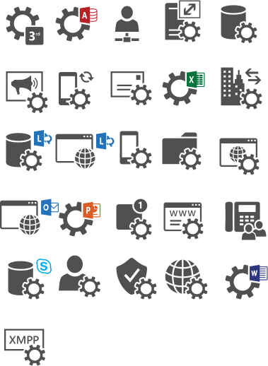

# Services

Icônes Office Symbols 2014 organisées par domaine fonctionnel. Répertoire source : `Services`.

Catalogue JSON : [icons.json](icons.json).

### Images SVG (29)

| Aperçu | Nom | Mots-clés | Taille | Fichier |
| --- | --- | --- | --- | --- |
|  | 3rd_Party_Service | officesymbols, services, 3rd, party, service | 97.125 × 97.5 | [3rd_Party_Service.svg](3rd_Party_Service.svg) |
|  | Access_Services | officesymbols, services, access | 101.1 × 91.5 | [Access_Services.svg](Access_Services.svg) |
|  | Business_Connectivity_Services | officesymbols, services, business, connectivity | 72 × 94.5 | [Business_Connectivity_Services.svg](Business_Connectivity_Services.svg) |
|  | Call_Admission_Control_Service | officesymbols, services, call, admission, control, service | 92.925 × 102 | [Call_Admission_Control_Service.svg](Call_Admission_Control_Service.svg) |
|  | Central_Management_Service | officesymbols, services, central, management, service | 89.625 × 94.5 | [Central_Management_Service.svg](Central_Management_Service.svg) |
|  | Conference_Announcement_Service | officesymbols, services, conference, announcement, service | 99 × 96 | [Conference_Announcement_Service.svg](Conference_Announcement_Service.svg) |
|  | Device_Update_Service | officesymbols, services, device, update, service | 87.525 × 97.5 | [Device_Update_Service.svg](Device_Update_Service.svg) |
|  | Email_Service | officesymbols, services, email, service | 102 × 87 | [Email_Service.svg](Email_Service.svg) |
|  | Excel_Services | officesymbols, services, excel | 108 × 90 | [Excel_Services.svg](Excel_Services.svg) |
|  | Federation_Service | officesymbols, services, federation, service | 99 × 96 | [Federation_Service.svg](Federation_Service.svg) |
|  | lib-office-services-drawio | officesymbols, services, lib, office, drawio | 379px × 518px | [lib-office-services-drawio.svg](lib-office-services-drawio.svg) |
|  | Lync_Storage_Service | officesymbols, services, lync, storage, service | 95 × 86 | [Lync_Storage_Service.svg](Lync_Storage_Service.svg) |
|  | Lync_Web_App_Client | officesymbols, services, lync, web, app, client | 119.1 × 75.8 | [Lync_Web_App_Client.svg](Lync_Web_App_Client.svg) |
|  | Mobility_Service | officesymbols, services, mobility, service | 84 × 97.5 | [Mobility_Service.svg](Mobility_Service.svg) |
|  | Network_File_Share_Service | officesymbols, services, network, file, share, service | 100.5 × 88.5 | [Network_File_Share_Service.svg](Network_File_Share_Service.svg) |
|  | Online_Hosted_Services | officesymbols, services, online, hosted | 101.7 × 90 | [Online_Hosted_Services.svg](Online_Hosted_Services.svg) |
|  | Outlook_Web_App | officesymbols, services, outlook, web, app | 130.5 × 94.5 | [Outlook_Web_App.svg](Outlook_Web_App.svg) |
|  | PowerPoint_Automation_Services | officesymbols, services, powerpoint, automation | 102.3 × 88.5 | [PowerPoint_Automation_Services.svg](PowerPoint_Automation_Services.svg) |
|  | Push_Notification_Service | officesymbols, services, push, notification, service | 90.525 × 97.5 | [Push_Notification_Service.svg](Push_Notification_Service.svg) |
|  | Registrar_Service | officesymbols, services, registrar, service | 102.9 × 88.5 | [Registrar_Service.svg](Registrar_Service.svg) |
|  | Response_Group_Service | officesymbols, services, response, group, service | 100.5 × 97.5 | [Response_Group_Service.svg](Response_Group_Service.svg) |
|  | Service | officesymbols, services, service | 44.49651 × 45.093174 | [Service.svg](Service.svg) |
|  | Skype_for_Business_Storage_Service | officesymbols, services, skype, for, business, storage, service | 98.625 × 102 | [Skype_for_Business_Storage_Service.svg](Skype_for_Business_Storage_Service.svg) |
|  | User_Services | officesymbols, services, user | 97.5 × 96 | [User_Services.svg](User_Services.svg) |
|  | Verification_Service | officesymbols, services, verification, service | 96 × 94.5 | [Verification_Service.svg](Verification_Service.svg) |
|  | Visio_Services | officesymbols, services, visio | 104.1 × 88.5 | [Visio_Services.svg](Visio_Services.svg) |
|  | Web_Services | officesymbols, services, web | 102 × 96 | [Web_Services.svg](Web_Services.svg) |
|  | Word_Automation_Services | officesymbols, services, word, automation | 101.7 × 88.5 | [Word_Automation_Services.svg](Word_Automation_Services.svg) |
|  | XMPP_Service | officesymbols, services, xmpp, service | 106.5 × 90 | [XMPP_Service.svg](XMPP_Service.svg) |
