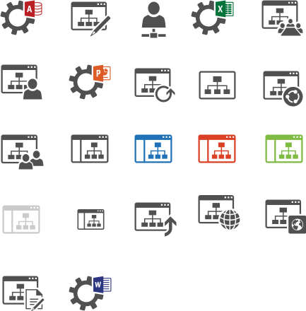
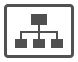
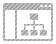
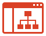
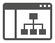

# Sites

Icônes Office Symbols 2014 organisées par domaine fonctionnel. Répertoire source : `Sites`.

Catalogue JSON : [icons.json](icons.json).

### Images SVG (23)

| Aperçu | Nom | Mots-clés | Taille | Fichier |
| --- | --- | --- | --- | --- |
|  | Access_Services | officesymbols, sites, access, services | 87.038 × 73.366 | [Access_Services.svg](Access_Services.svg) |
|  | Blog_Site | officesymbols, sites, blog, site | 83.1 × 73.3 | [Blog_Site.svg](Blog_Site.svg) |
|  | Business_Connectivity_Services | officesymbols, sites, business, connectivity, services | 53.4 × 76 | [Business_Connectivity_Services.svg](Business_Connectivity_Services.svg) |
|  | Excel_Services | officesymbols, sites, excel, services | 88.038 × 73.566 | [Excel_Services.svg](Excel_Services.svg) |
|  | lib-office-sites-drawio | officesymbols, sites, lib, office, drawio | 433px × 440px | [lib-office-sites-drawio.svg](lib-office-sites-drawio.svg) |
|  | Meeting_Workspace_Site | officesymbols, sites, meeting, workspace, site | 86.1 × 75.3 | [Meeting_Workspace_Site.svg](Meeting_Workspace_Site.svg) |
|  | My_Site | officesymbols, sites, my, site | 85 × 73 | [My_Site.svg](My_Site.svg) |
|  | PowerPoint_Automation_Services | officesymbols, sites, powerpoint, automation, services | 87.038 × 72.966 | [PowerPoint_Automation_Services.svg](PowerPoint_Automation_Services.svg) |
|  | Publish | officesymbols, sites, publish | 84 × 72 | [Publish.svg](Publish.svg) |
|  | Site_Collection | officesymbols, sites, site, collection | 78 × 62 | [Site_Collection.svg](Site_Collection.svg) |
|  | Site_Shared | officesymbols, sites, site, shared | 83 × 75 | [Site_Shared.svg](Site_Shared.svg) |
|  | Site_Team | officesymbols, sites, site, team | 87 × 73 | [Site_Team.svg](Site_Team.svg) |
|  | Subsite-blue | officesymbols, sites, subsite, blue | 79 × 62 | [Subsite-blue.svg](Subsite-blue.svg) |
|  | Subsite-ghosted | officesymbols, sites, subsite, ghosted | 79 × 62 | [Subsite-ghosted.svg](Subsite-ghosted.svg) |
|  | Subsite-green | officesymbols, sites, subsite, green | 79 × 62 | [Subsite-green.svg](Subsite-green.svg) |
|  | Subsite-orange | officesymbols, sites, subsite, orange | 79 × 62 | [Subsite-orange.svg](Subsite-orange.svg) |
|  | Subsite | officesymbols, sites, subsite | 79 × 62 | [Subsite.svg](Subsite.svg) |
|  | Upgrade_Site | officesymbols, sites, upgrade, site | 87 × 72.8 | [Upgrade_Site.svg](Upgrade_Site.svg) |
|  | Visio_Services | officesymbols, sites, visio, services | 87.9 × 72.966 | [Visio_Services.svg](Visio_Services.svg) |
|  | Website | officesymbols, sites, website | 87 × 74 | [Website.svg](Website.svg) |
|  | Website_Public | officesymbols, sites, website, public | 86 × 72 | [Website_Public.svg](Website_Public.svg) |
|  | Wiki_Site | officesymbols, sites, wiki, site | 86.9 × 75 | [Wiki_Site.svg](Wiki_Site.svg) |
|  | Word_Automation_Services | officesymbols, sites, word, automation, services | 88.038 × 72.666 | [Word_Automation_Services.svg](Word_Automation_Services.svg) |
